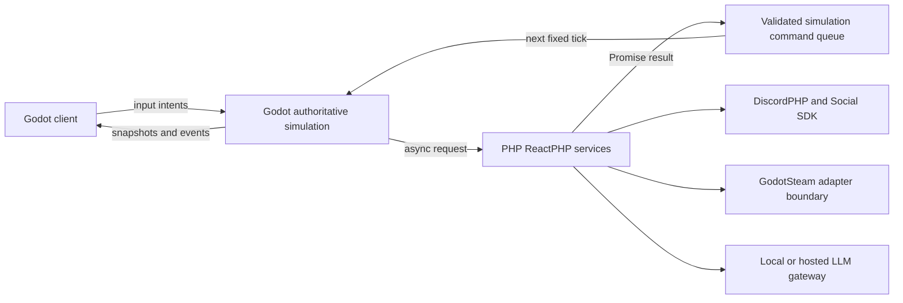

# Runtime foundations

> Current cooperative prototype status (2026-10-10): see [agent handoff](../development/FIRST_PLAYABLE_HANDOFF.md) and [acceptance evidence](../development/first-playable-acceptance.md). Older sections describe their original development slices; the separate first-playable scene adds authenticated networking, physical production items and durable checkpoints.

[Localized injuries](localized-injuries.md) now provide part-specific blunt/burn records, oxygen injury, trusted queued changes and derived knockout causes connected to inventory incapacity. V2 health snapshots preserve damage and migrate v1 sources; physical impact, finite treatment resources and player UI remain pending.

[Public server status](public-server-status.md) now has a separate bounded promise-based PHP cache and safe Twitch channel projections, with freshness, source scope and rebind-race checks. TwitchPHP is the preferred future OAuth/Helix/EventSub provider; live service/panel wiring remains pending.

[Optional Twitch integration](../design/twitch-streamer-integration.md) now has a separate MIT/PSR-4 asynchronous outgoing chat adapter. Incoming EventSub, OAuth, public server-status projection and a streamer Panel Extension are staged future integration; ticks never depend on Twitch responses.

[Basic inventory consciousness capabilities](inventory-consciousness-capabilities.md) now reject unconscious actor commands, cancel voluntary work/grips and revoke external search views, while retaining passive-target interaction and recovery. Basic gameplay has priority; away missions and planetary streaming remain future work.

[Seeded away missions](../design/seeded-away-missions.md) are planned disposable planet instances: departing/ending a mission retires its identity and permanently loses all unextracted contents. Atomic exports, crew-aware closure, crash-safe cleanup and bounded memory reclamation are specified; no mission runtime exists yet.

[Procedural planets](../design/procedural-planets-and-memory-budgets.md) are now a documented future requirement with separated generation/residency/persistence providers, peak-byte admission, streamed LOD/collision, durable terrain edits and explicit dormant/deletion rules. No planet streaming runtime is implemented yet.

[Health runtime](health-runtime.md) now registers bounded phased consciousness assessments in world ticks/saves, with trusted queued sources, body-link validation, legacy migration and timebases. [Owner optimizations](../../reports/performance/owner-optimization.md) measured about 12.5×/25× improvements for consciousness/motion commits. Injuries, finite chemistry and action enforcement remain pending.

[Consciousness ownership](consciousness-ownership.md) now commits single-body assessments atomically with current revision/freshness guards, saved recovery state and bounded retry receipts. Runtime health scheduling, trusted injuries/chemicals and capability-transition consequences remain pending.

[Consciousness foundation](consciousness-foundation.md) now implements detached v1 records and pure combined-cause assessment with impairment hysteresis, knockout, sustained recovery and gap reset. Runtime health ownership, finite chemistry and body input enforcement remain pending.

[Consciousness](../design/health-medicine-and-chemistry.md#consciousness-knockout-and-sustained-unconsciousness) is now an explicit planned health feature: injury knockouts, sustained chemical sedation, combined continuing causes and capability-gated recovery. It remains separate from posture, paralysis, death and player identity; no runtime implementation exists yet.

[Physical combat](../design/combat-restraint-and-body-transport.md#physics-driven-combat-and-vr) now explicitly requires authoritative hand/tool collision, impact-derived injury, constrained VR proxies and equivalent desktop input paths. Angular motion, work accounting and physical body integration are prerequisites; tracked presentation alone cannot supply combat authority.

[Combat, restraint and body transport](../design/combat-restraint-and-body-transport.md) are planned requirements for knockdowns, contested holds, dragging/carrying, movable supports and welded-container confinement. They compose health, physical grips, occupancy and motion rather than placing players in inventory.

[Health, medicine and chemistry](../design/health-medicine-and-chemistry.md) are planned requirements for localized organic injuries, synthetic/hybrid treatment, chemical containment and metabolism, and staged medical work. Proposed ownership and acceptance stages are documented; no medical runtime is implemented yet.

[Spatial XR controls](xr-spatial-controls.md) now provide a debug airlock panel with right-hand aim, physics-frame occlusion, release/press gates and queued shared commands. Authenticated player/body reach validation and Quest hardware checks remain pending.

[XR comfort controls](xr-comfort-controls.md) now add local snap turns, seated offsets, focused/tracked input gates and bounded preferences to optional VR presentation. They preserve canonical world state and the simulation rate.

[Optional OpenXR presentation](../development/quest-3-vr-testing.md) now supplies an opt-in PC VR rig and launcher with a Quest 3/SteamVR testing path. Tracking/input feedback stays outside canonical state; native hardware checks and gameplay interaction adapters remain pending.

[Linear motion ownership](linear-motion-ownership.md) now provides paired atomic impulse commits, independent owner/body revision guards and saved bounded retry receipts. It remains a domain component pending fixed-tick world, collision and work/resource integration.

[Push-off momentum](push-off-momentum.md) adds pure integer mass/momentum records and two-body normal impulse plans. Reactions conserve linear momentum exactly; body integration, angular motion, atomic commits and work/resource accounting remain future runtime responsibilities.

[Local grip controls](local-grip-panel.md) now expose queued development interactions inside the existing inventory HUD. Scoped v2 observations describe own hand states/sessions and public fixture metadata; they remain disposable presentation rather than canonical motion.

[Local inventory/grip integration](inventory-grip-runtime.md) now composes physical grip ownership in the existing inventory simulation system, with queued development intents, reserved-hand arbitration, logical contact-loss cleanup and v4 saves. It evaluates capability without applying object/body forces.

[Physical grip ownership](physical-grip-ownership.md) adds a bounded domain owner for sustained traversal/manipulation sessions, exclusive hands, cooperative participants, retained receipts and paused recovery. It requires trusted observations and future fixed-tick/authenticated/inventory/physics integration before exposing gameplay controls.

[Gravity and EVA locomotion](../design/gravity-and-eva-locomotion.md) now have a pure local-frame policy under `src/core/locomotion/`, with natural/generated/freefall resolution and separate magnetic attachment/jetpack availability. It is not yet a runtime force or resource-consumption system.

[Inventory spatial state](inventory-spatial-state.md) now uses integer 3D coordinates and conservative Euclidean reach, with v3 save migration. An opt-in client capsule adapter queues local development movement; authoritative server physics and production movement/control contracts remain pending.

The client [world inventory preview](procedural-world-inventory-preview.md) renders validated v2 tray/item observations with native geometry, bounded pick proxies and an ID-only collection bridge into queued inventory commands. It is disposable presentation, independent of authoritative player/item physics.

[World inventory pickup/drop](world-inventory-interactions.md) now uses registered non-body storage, logical reach checks and the common shared-owner commit/receipt path. Loaded items retain their whole subtree. System snapshot v2 preserves location metadata while accepting prior v1 records.

[Self inventory actions](self-inventory-actions.md) now expose queued hand selection, slot equipment and owned storage movement through the shared transaction owner. The client uses own observation v2 for nested possessions and slot/container choices; production player physics and transport remain separate gates.

A [local inventory demo panel](local-inventory-panel.md) now presents scoped observations and queues interactions through the fixed-tick command path. It joins the customizable HUD as `hud.inventory`; prior section profiles receive an additive migration. This is independent of the walking preview body and remains local-development-only.

The [inventory runtime](inventory-runtime.md) now registers shared ownership, bounded interaction jobs and scoped searches with fixed ticks and world snapshots. Its commands are restricted to debug local fixture principals; logical positions/open access paths are development assumptions pending real player-physics and production session adapters.

The [shared inventory coordinator](shared-inventory-transactions.md) owns one ledger plus body equipment records and retained receipts, enabling atomic cross-body transfers and timed job completion without independent mutable ledger copies. It remains a domain foundation pending authenticated runtime registration.

[Body inventory state](body-inventory-equipment.md) now combines equipment bindings, active hands and ledger ownership with atomic revision-checked operations. Loaded containers are checked against their equipment slots and body carry limit. Authenticated tick commands, shared-region coordination and inventory UI remain pending.

The client [HUD section stack](overlay-section-runtime.md) supports selectable Expanded/Compact profiles, local JSON mods and saved adjacent reorder/collapse edits. Host-owned status/reset policies and the existing command callbacks are preserved. These records remain local presentation preferences.

Client overlays use [validated appearance themes](../design/customizable-overlays.md), with Frontier, Terminal and High contrast presets, local JSON mods and a persisted theme picker. [Panel layouts](overlay-layout-runtime.md) add selectable order/orientation, space weights and responsive stacking. Both stay in presentation code and do not enter world snapshots. General HUD widget extensions remain future work.

The [player inventory specification](../design/player-inventory-and-equipment.md) defines body-specific slots, selectable hands, nested containers and shared item/material ownership. `src/core/inventory/` provides equipment profiles and an [ownership ledger](inventory-ownership-ledger.md) with trusted item definitions, bounded nested containers and atomic revision-checked transfers. System registration, authenticated gameplay commands, equipment state and runtime UI remain pending.

The [material and terrain foundation](../design/materials-terrain-and-reconstruction.md) supplies revisioned definitions and pure mass-conserving excavation/fill plans under `src/core/materials/`. Dirt supports terrain placement, crafting feedstock and hydroponic substrate. Inventory transactions, runtime terrain editing and general deconstruction remain pending; plans alone never change the world.

The [control circuit runtime](control-circuit-runtime.md) owns installed modules, board changes and bounded wired delivery. `MachineControlSystem` registers one prototype host with world ticks and snapshots, rebuilding trusted latch bindings on restore. [Local maintenance commands](machine-maintenance.md) add isolation, part transfers and rewiring with a saved shared tray. Production construction authority, generalized hosts and spatial radio remain pending.

## Authority boundaries



The simulation owns real-time state and never waits for Discord, a database, Steam, or an LLM. PHP service integrations use ReactPHP promises and event-loop I/O. A completed integration request is validated at its boundary and represented as a command; the authoritative simulation applies that command during a later fixed tick. Service failure, timeout, disconnection, and overload must be explicit outcomes rather than stalls.

External command intent and authenticated actor context are different types. Version 1 intent carries a request ID, world/region IDs, a registered command type, and typed payload; the server attaches the principal from its authenticated session after receiving it. The current local demo creates a development-only context. The command and snapshot persistence contracts, including idempotency and restart limits, are documented in [Persistence and Command Boundary](../design/persistence-and-command-boundary.md).

In-game PDA conversations are separate from Discord/social chat and voice. PDA note reads, plan drafts, and provider calls use the authenticated game principal and explicit selected context. Store notes and plans as versioned server records; LLM output is an editable draft, and mechanical work begins only when a player submits it through the ordinary work-order and simulation-command boundaries. See [PDA Notes and Planning Assistant](../design/pda-planning-assistant.md).

## Hosting modes

The same headless Godot world-host build is intended to support both community-hosted and official worlds. Hosting ownership changes deployment configuration and operations, not simulation rules or the command protocol. Community operators and the official service must use the same versioned world, identity, and persistence interfaces; each host configures its own credentials, backups, access policy, and service endpoints. The first runnable development mode is a local headless host. Official hosting operations, public account bootstrap, and production persistence remain later implementation work.

## Godot structure

- `src/core/components/` provides node composition for entity capabilities.
- `src/core/control/` defines machine modules, mounting slots, compatible signal ports, and a bounded definition catalog with a trusted-handler allowlist. These are detached data contracts, with examples under `data/control/`; no module handler or signal-delivery simulation is attached to the current runtime. See [Modular controls and machine signals](../design/modular-controls-and-signals.md).
- `src/core/access/` owns versioned device access, security-controller and actuator records, staged bypass jobs, and bounded tamper history. Tool instance IDs enter only through the server-created `AuthenticatedCommandContext`; local development uses synthetic tools until an authoritative inventory system exists.
- `src/core/simulation/` defines fixed-tick systems, external-command ingress, and first-pass per-system profiling.
- `src/core/runtime/` composes one world region and defines the versioned snapshot envelope exchanged with persistence services.
- `src/core/pressure/` contains the first isothermal gas-volume solver, ideal sensor records, and a command-interlocked habitat airlock prototype. Its exact assumptions and current limits are recorded in `docs/design/survival-pressure-and-recovery.md`.
- `src/core/async/` queues promise continuations outside physics callbacks and processes a bounded number per render frame. Its pending queue is capped; overflow rejects the affected continuation with a typed `ServiceResult` instead of growing without limit.
- `src/core/cache/` holds bounded TTL/LRU caches for derived, non-authoritative data only.
- `src/core/services/` holds result envelopes shared by integration adapters.
- Integration code belongs in dedicated folders such as `src/integrations/steam/` and `src/integrations/discord/`; do not call plugin globals from gameplay systems.

The component host must be a child of an entity node. Components have stable keys, explicit attach/detach hooks, and no authority just because they are installed. Capability registries and server validation will define what operations a component can perform.

Machine-function requirements describe dependencies individually, so loss of a receiver disables reception while an intact manual door path remains usable. PDA and receive-only door slot examples enforce different module roles. `AirlockCommand.manual_operation` selects a separate prying-tool/latch/load validation path; ordinary powered commands require control power. The prototype uses server-context tool IDs and fixed manual-force limits until inventory, independent drive power, and tool ratings are implemented.

Stock slot layouts are replaceable hardware, not permanent device-role restrictions. `MachineControlBoardDefinition` parses versioned layouts and plans board swaps without mutating equipment, retaining existing modules or requiring explicit relocation/removal work. General utility bays accept every physically compatible family. Slot `accepts()` checks mounting; `evaluate_operability()` reports missing host services separately. Cable attachment also permits semantically inert wiring while signal transfer remains typed. These planners and an expanded door-board/igniter fixture are implemented; actual construction jobs and ignition handlers are not connected to the runtime.

## Versioned world snapshots

`WorldSnapshot` is the JSON-compatible value envelope between the Godot simulation and PHP persistence. Its current contract is [world-snapshot-v1.schema.json](../schema/world-snapshot-v1.schema.json): world ID, region ID, simulation tick, and versioned records keyed by stable simulation-system IDs. Every system owns its state record and validates it; pressure volumes, airlocks, sensors, and access-control devices currently have independent schema versions. The access-control system uses [access-control-system-v1.schema.json](../schema/access-control-system-v1.schema.json) and per-device [access-control-v1.schema.json](../schema/access-control-v1.schema.json) records. Serialized IDs are strings, and the JSON writer retains full floating-point precision. Pressure ticks apply sequential airlock transfers in lexical stable-ID order, matching snapshot ordering so restoring a shared-volume topology preserves the next tick. `packages/world-contracts` defines the matching PHP snapshot document and asynchronous compare-and-swap repository contract; it has no database adapter yet.

Snapshots include canonical domain values only. They exclude scene nodes, presentation state, caches, promise continuations, and pending commands. The runner refuses capture during a tick or while commands are pending. Restore validates the complete system set, each system record, and the pressure/actuator cross-reference before applying state, and is allowed only before the runner has started. A legacy pressure-only snapshot gets default locked access records for its saved airlocks before cross-validation; active grants are never inferred from old state. The bootstrap starts the local simulation explicitly; a future persistence loader can restore first and then start without blocking a running tick. `WorldRuntime.capture_world_snapshot_json()` and `restore_world_snapshot_json()` expose the codec boundary, but durable files, PHP storage, and transaction semantics are not implemented yet. Unknown schema versions fail explicitly; migrations belong at the persistence boundary before a current-version snapshot is restored.

## PHP structure

Each service/library lives under `packages/` or `services/`, has its own `composer.json`, and exposes PSR-4 namespaces. The initial `php-foundation` package contains reusable asynchronous helpers; `control-plane` is an independently runnable ReactPHP application. Use ReactPHP `PromiseInterface` and `CacheInterface` directly at service boundaries. `RememberingCache` adds cache-aside behavior and coalesces same-key concurrent misses; its LRU storage and TTL are intentionally disposable. Add note/plan/conversation DTOs, ACL policy, validation, and persistence behind a dedicated PSR-4 package boundary when the PDA records reach their first consumer; the shared schemas are [crew-note-v1](../schema/crew-note-v1.schema.json), [work-plan-v1](../schema/work-plan-v1.schema.json), and [llm-conversation-v1](../schema/llm-conversation-v1.schema.json).

Run the control plane from `services/control-plane/` after Composer dependencies are installed:

```powershell
composer install
$env:FRONTIER_CONTROL_PLANE_ADDRESS = '127.0.0.1:8080'
php .\bin\control-plane.php
```

`GET /health` is a liveness response and `GET /metrics` returns a small runtime snapshot. These endpoints are not an admin API and expose no credentials.

## GodotSteam and social services

GodotSteam 4.23.1 is installed in `addons/godotsteam/` and is loaded as an external MIT GDExtension. Keep Steam lobby, identity, achievements, and multiplayer behavior behind the project-owned `GodotSteamProvider`; do not expose the native singleton to simulation systems. Initialization is explicit and must happen during startup, outside a simulation tick. Valve's Steamworks SDK terms remain separate from GodotSteam's MIT license and must be tracked for shipped native binaries.

DiscordPHP and the Discord Social SDK belong behind a separate PHP/client adapter boundary. Voice and chat must not be reimplemented in the simulation loop. PHP service promises and Godot callback promises are scheduling tools; neither should allow service responses or generated text to bypass access checks, user permissions, or server-side command validation.

## Profiling and overload behavior

`SimulationRunner.profiling_snapshot()` reports tick budget, queue pressure, dropped external commands, per-system execution cost and separate capture overhead. [Bounded tick profiling](tick-profiling.md) adds opt-in recent history and numeric system counters through `WorldRuntime`. The dispatcher reports queued, completed, and peak continuation counts. Future metric export must remain asynchronous and must not serialize live scene trees.

The first prototype intentionally rejects external command ingress when its configured queue is full. Production adapters must surface that rejection to the requester, apply rate limits, and record it. Commands are typed `SimulationCommand` objects and are revalidated immediately before application. Do not silently drop a command or run it on an arbitrary callback thread.

## Production gameplay

The [finite production loop](production-gameplay-loop.md) is registered in client and headless worlds. It provides shared fixture mining, refining, chemical processing/dispensing, crafting, construction/deconstruction and recycling, with reserved batches and persistent material/energy state. The [portable resource bridge](portable-resource-carriers.md) attaches payloads to physical inventory canisters and includes their mass in carried/equipment capacities. Atmospheric construction and network sessions remain separate integrations.

## Wider foundation limitations

The current code is a local prototype, not the persistence/networking implementation. The client can submit airlock and bypass-job commands through the fixed-tick queue and observe pressure/access state; both simulation systems have versioned snapshot contracts, but no durable world record or database integration exists. There is no player movement, network session, blueprint loader, actor authentication, or reconnect flow yet. The access-control slice uses synthetic debug tool IDs and session-provided verified tool IDs; it has no authoritative inventory, spatial/panel access, real ACL policy evaluator, repairable bypass faults, or electrical hazard model. Mechanical bypass releases a latch but does not force an unsafe door open. The pressure solver is an isothermal ideal-gas demonstration, not the production gas/liquid network. Durable world storage, schema migrations, authoritative multiplayer replication, identity/ACLs, blueprint contracts, deterministic automation DSL, Discord Social SDK flows, Steam lobby/multiplayer provider methods, and LLM tool schemas need dedicated implementation contracts before production use. The first survival, pressure, docking, and salvage rules are captured in `docs/design/survival-pressure-and-recovery.md`.
